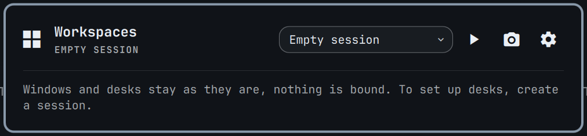

# Workspaces

Workspaces with app bindings, names and sessions.

## Colours

Status colours (red, orange) are fixed rather than the theme's, whose red or
yellow can be any colour: `FixedColors.qml` reads them from
`~/.config/omarchy/predmaxim/palette.json` (`{"red": "#e5534b", ...}`) and
falls back to the theme's alert colour without that file.
